# Route Planner

Build your own step-by-step routes for Old School RuneScape and follow them in game with a path to walk, highlights, and an on-screen guide. Like a quest helper, but for any goal you set yourself: skilling grinds, item runs, diary tasks, or a whole account plan.

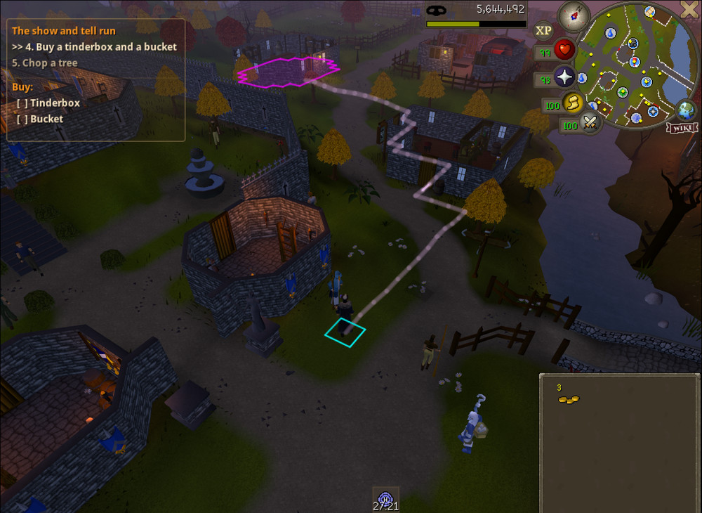

- [Getting started](#getting-started)
- [The panel](#the-panel)
- [Building routes](#building-routes)
- [Record mode](#record-mode)
- [Step types](#step-types)
- [Highlighting](#highlighting)
- [Waypoint path](#waypoint-path)
- [Route Hub](#route-hub)
- [HUD](#hud)
- [Credits](#credits)

## Getting started

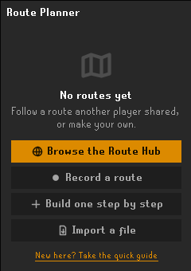

1. Open **Route Planner** from the RuneLite toolbar.
2. Pick how to start:
   - **Browse the Route Hub**: install a community route.
   - **Record a route**: play normally and let the plugin write the steps.
   - **Build one step by step**: name your route and add steps.
   - **Import a file**: load a route someone sent you. Importing a newer copy of a route you already have offers to replace it, keeping the steps you've ticked off.
3. Leave edit mode (the pencil) and follow the line. Steps tick off as you do them.

New to the plugin? The **quick guide** on the welcome screen (also in the route menu) walks through it in five short pages.

 

## The panel

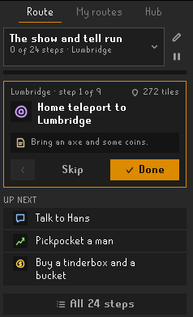

- **Route** tab: the active route, with a card for the current step showing what to do, plus **Back**, **Skip** and **Done**. Switch routes from the dropdown at the top.
- **My routes** tab: all your routes. Use a route's **...** menu to rename, reset progress, export, share or delete it, or make it **repeatable** so it starts over by itself when you finish.
- **Hub** tab: browse and install community routes.
- **Pause** hides a route's path and HUD until you pick it again.

 

## Building routes

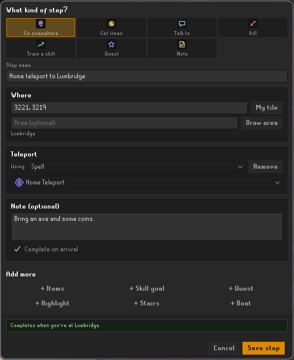

- Click the pencil to enter edit mode, then use **+ Step** and **+ Section**. Sections group steps into chapters.
- **+ Step** opens a quick editor: choose what the player does (**Go somewhere, Get items, Talk to, Kill, Train a skill, Quest** or **Note**) and fill in only what you need. **Add more** puts extras on any step: items, a skill goal, a quest, highlights, stairs or a boat.
- Hold **Shift** and right-click any tile in game, then pick **Add Location Step** to make a step with that tile already filled in.
- Drag steps to reorder them or move them between sections. Double-click to edit; right-click for more.
- Undo and redo structural edits. Each route keeps its own history.
- Import and export routes as files to share or back them up.

 

**Areas.** For a big place, press **Draw area** in the step editor and drag over the ground in game. The step then counts as reached anywhere inside the area, which is outlined on the ground, the minimap and the world map.

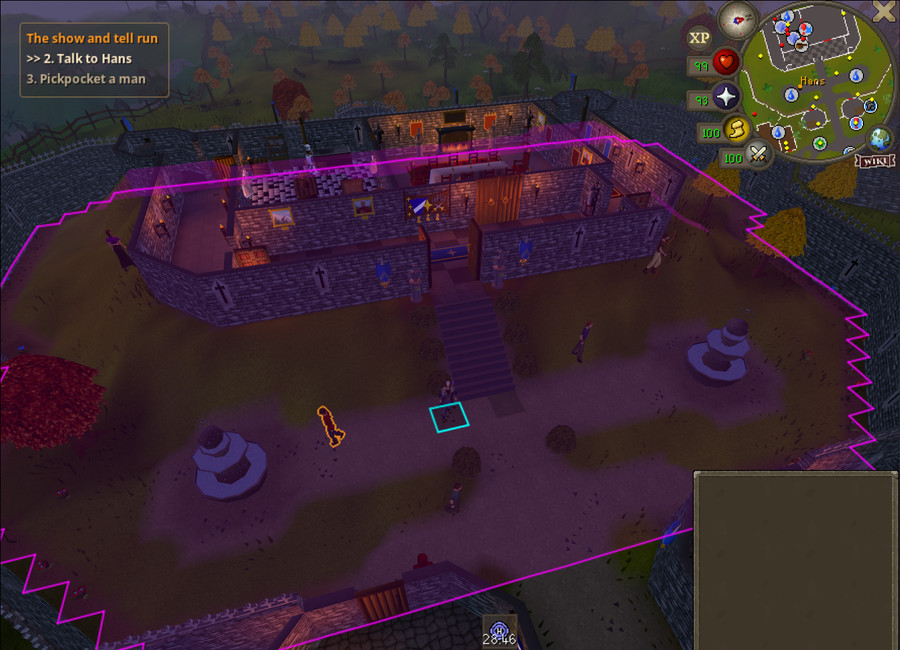

## Record mode

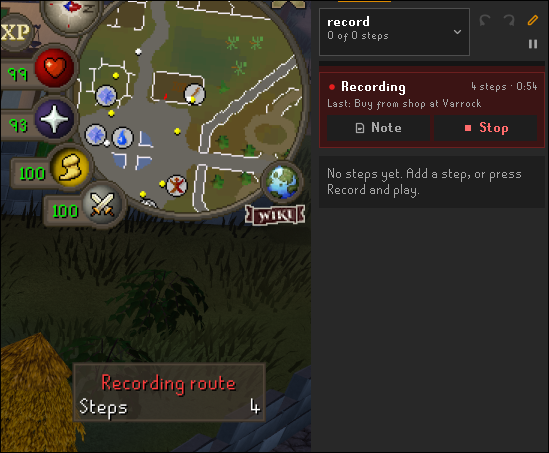

Press **Record** and play normally. Walking, teleports, stairs and ladders, talking to NPCs, banking, buying, selling, picking things up, skilling, agility courses, kills and quests all turn into draft steps as you go.

- Press **Note** while recording to add a tip to the current step.
- Press **Stop** to review what was recorded (keep it, fix it or discard it) before it joins your route.
- Each recording goes into a new section, so you can record a route in parts.
- Settings under **Record mode** control how long you stand still before a new step starts, and whether recorded NPCs and objects are highlighted.

 

## Step types

| Step | What it does |
|---|---|
| **Go somewhere** | Pathfinds to a tile and draws the way on the world map, the minimap and the game scene. Stairs, ladders, dungeon entrances, fairy rings, spirit trees, gnome gliders, charter ships, shortcuts and more are found for you, and the next one lights up as you approach. A step can also say how to get there: a spellbook or minigame teleport, a teleport item, or the Portal Nexus, with each click highlighted. |
| **Get items** | Items to bring from the bank, buy at a shop, sell or pick up. Missing items show in orange and items you have in green. A step can also be "deposit everything". |
| **Talk to** | An NPC to talk to, with the chat options to pick highlighted in order. |
| **Kill** | An NPC to kill, completing after a set number of kills. |
| **Train a skill** | A skill and a target (level, XP total or XP gained), with an optional method such as foods, bars, logs, potions, rocks, trees, pickpocket targets or agility courses. |
| **Quest** | Completes when the quest is finished. While it's active, the quest's row in your quest list lights up, so you can right-click it and **Start Quest Helper** if you use that plugin. |
| **Note** | Free-form text shown on the step. |

A step completes on its own once everything it tracks is done. For example, a step that fetches items and has a skill goal completes only when you have the items **and** reach the goal.

## Highlighting

Each step can point you at exactly what to click. In-game highlighting is opt-in per step.

<table>
<tr>
<td width="50%">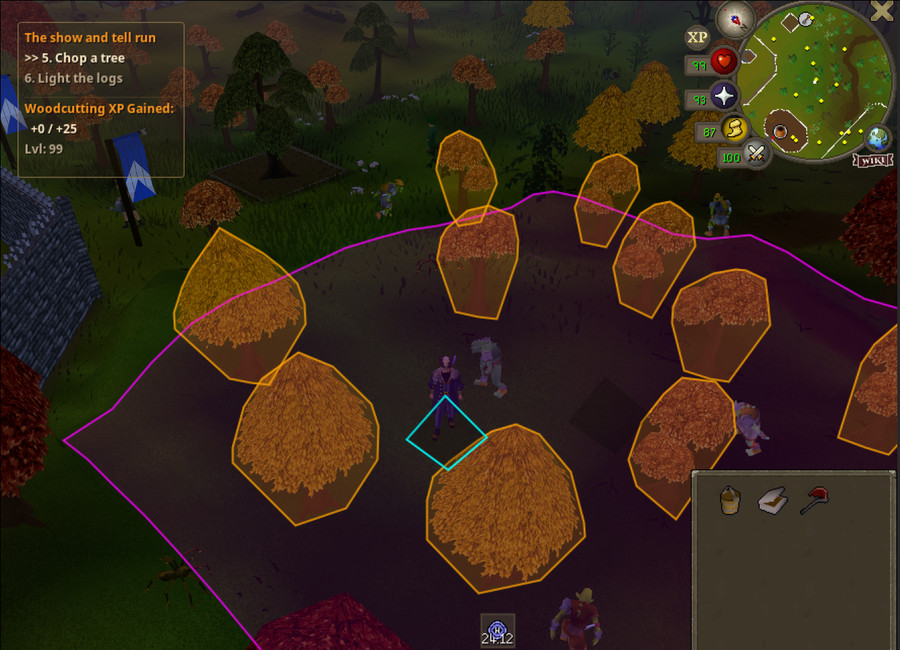 <b>NPCs and objects</b>: the trees, rocks or NPCs the step needs.</td>
<td width="50%">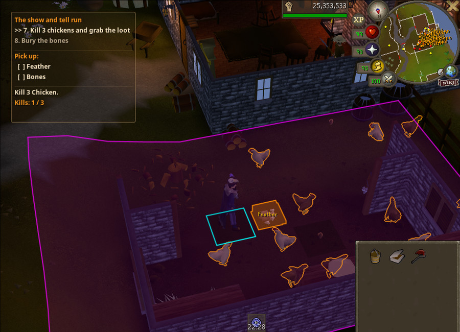 <b>Kills and loot</b>: targets, ground items to pick up, and a kill count.</td>
</tr>
<tr>
<td width="50%">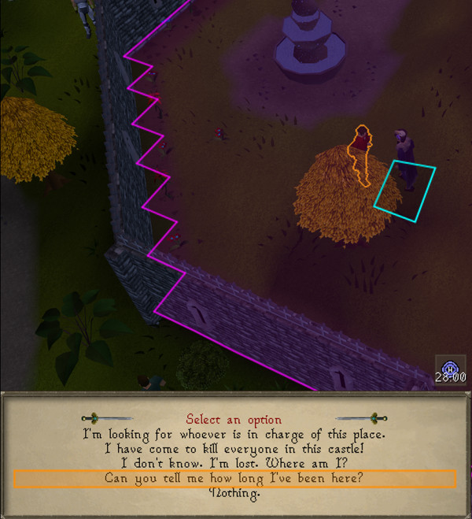 <b>Dialogue</b>: the chat option to pick, in order.</td>
<td width="50%">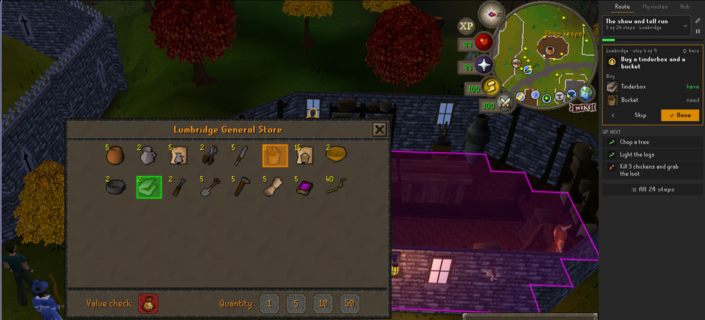 <b>Shops</b>: what to buy, with what you still need on the step card.</td>
</tr>
<tr>
<td width="50%">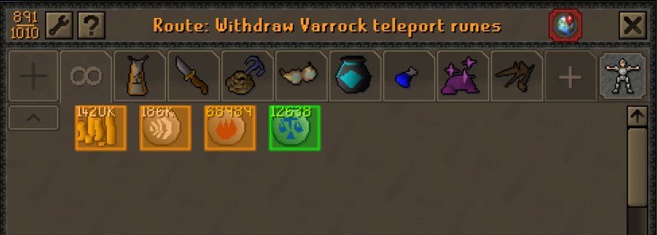 <b>Bank tab</b>: your bank filtered down to just what the step needs.</td>
<td width="50%">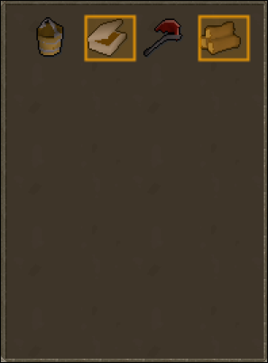 <b>Inventory</b>: items to use or wear, like a tinderbox on logs.</td>
</tr>
</table>

## Waypoint path

Draw the way to your next destination as a line, as highlighted tiles, or both.

<table>
<tr>
<td width="33%">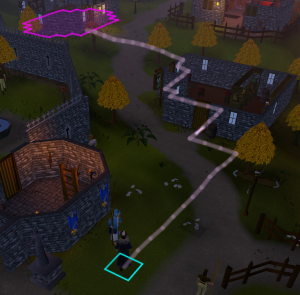 <b>Line</b></td>
<td width="33%">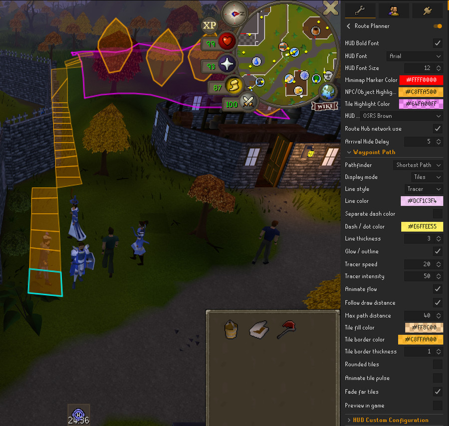 <b>Tiles</b></td>
<td width="33%">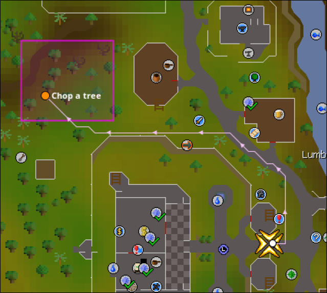 <b>World map</b></td>
</tr>
</table>

- **Line**: solid, dashed, dotted, dash-dot or tracer, with adjustable colour, transparency, thickness, an optional glow, and an optional separate dash colour.
- **Tiles**: adjustable fill and border colour, border thickness, rounded corners, a gentle pulse, and fading for tiles further along the path.
- The path is clipped to the client's draw distance, or to a limit you set.
- **Preview in game** draws a short demo path beside you so you can try your settings without an active route.
- **Pathfinder**: use the built-in pathfinder, or the [Shortest Path](https://runelite.net/plugin-hub/show/shortest-path) plugin if you have it installed. If Shortest Path is off or doesn't answer, the built-in one is used.

## Route Hub

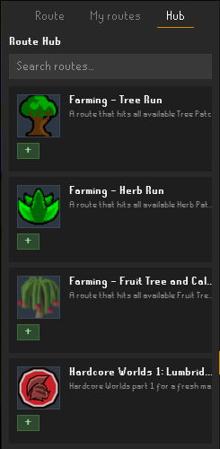

Browse and install community-made routes from the **Hub** tab.

- The plugin fetches route data (read-only) from a GitHub-hosted repository. No player information, account data, or anything else about you is ever sent: only plain GET requests for the catalog, route files and icons.
- Sharing goes the other way: **My routes → ... → Share to the Route Hub** helps you open a pull request on GitHub yourself. The plugin never uploads anything on your behalf.
- Every submission is reviewed before it's added, and route text is checked for links when it's created and installed. Even so, routes are community content: never follow a step that asks you to visit a website, share account details, or do anything outside the game.

 

## HUD

<table>
<tr>
<td width="50%">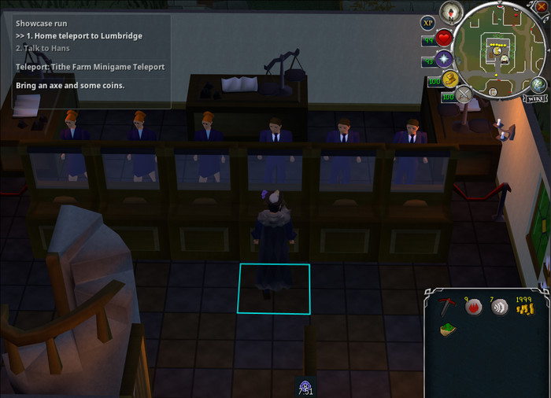</td>
<td width="50%">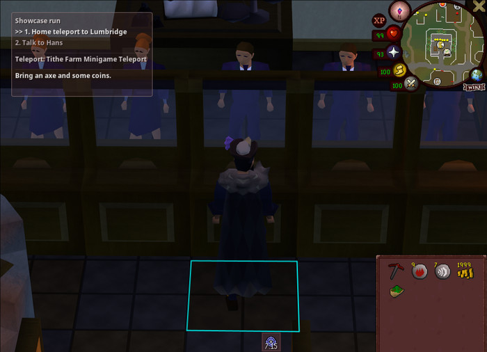</td>
</tr>
</table>

- Shows the current step, its goal and what you still need. It hides itself while the bank is open.
- Preset themes (OSRS Brown, Quest Helper style) or a fully **Custom** theme.
- Per-element colours for the body, outline, title, step text and dividers, each with transparency control.
- Outline on/off and thickness, font family (RuneScape fonts or system fonts) and font size.
- **Match HUD to interface**: build a matching HUD palette from your resource pack's overlay colour.

## Credits

Pathfinding relies on collision-map and transport data from the excellent [Shortest Path](https://github.com/Skretzo/shortest-path) plugin by Runemoro and Skretzo. See [`NOTICE`](NOTICE) for third-party attribution.

## License

Released under the BSD 2-Clause License. See [`LICENSE`](LICENSE). Created by BlackDeath_Osrs.
